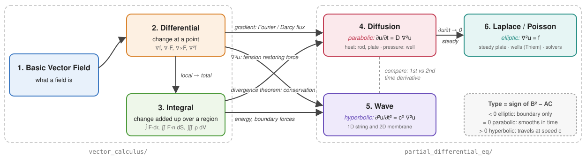

# Partial Differential Equations: elliptic, parabolic and hyperbolic

Three classic PDEs built on the vector calculus in [`../vector_calculus`](../vector_calculus/README.md), one of each type. All three are built around the same operator, the Laplacian $\nabla^2 u$. What changes is the time derivative next to it, and that sets the type.

| Step | Notebook | Type | Question it answers | Colab |
|---|---|---|---|---|
| 4 | [Diffusion_Equation.ipynb](Diffusion_Equation.ipynb) | parabolic | How do heat (rod, plate) and pressure (around a well) spread over time? | [open](https://colab.research.google.com/github/agugun/axscnt-notebook/blob/main/partial_differential_eq/Diffusion_Equation.ipynb) |
| 5 | [Wave_Equation.ipynb](Wave_Equation.ipynb) | hyperbolic | How do vibrations travel along a string (1D) and across a drum (2D)? | [open](https://colab.research.google.com/github/agugun/axscnt-notebook/blob/main/partial_differential_eq/Wave_Equation.ipynb) |
| 6 | [Laplace_Poisson_Equation.ipynb](Laplace_Poisson_Equation.ipynb) | elliptic | What is left once everything stops changing (steady temperature, steady pressure around wells)? | [open](https://colab.research.google.com/github/agugun/axscnt-notebook/blob/main/partial_differential_eq/Laplace_Poisson_Equation.ipynb) |

Steps 1 to 3 (fields, the differential notebook and the integral notebook) are in [`vector_calculus/`](../vector_calculus/README.md). "Step 2" and "step 3" below refer to them. Steps 4 and 5 can be read in either order. Step 6 is easiest after step 4, because it treats steady state as the end of diffusion.

## Classification: elliptic, parabolic, hyperbolic

A second-order linear PDE in two variables,

$$A\,u_{xx} + 2B\,u_{xy} + C\,u_{yy} + (\text{lower-order terms}) = 0,$$

is classified by the sign of $B^2 - AC$, much like conic sections: ellipse, parabola, hyperbola. Time counts as one of the variables.

| Type | $B^2 - AC$ | Prototype | Describes | Data needed | Information travels | Numerical approach | Notebook |
|---|---|---|---|---|---|---|---|
| **elliptic** | $< 0$ | Laplace/Poisson $\nabla^2 u = f$ | equilibrium, steady state | boundary values only | everywhere at once: each point feels the whole boundary | one linear system for the whole grid (direct, or Jacobi / Gauss–Seidel / SOR) | step 6 |
| **parabolic** | $= 0$ | diffusion $u_t = D\nabla^2 u$ | smoothing toward equilibrium | initial + boundary values | instantly, but fading with distance ($\sim\sqrt{4Dt}$) | march in time; explicit needs $r \le \tfrac12$ (1D), $\tfrac14$ (2D); implicit is unconditionally stable | step 4 |
| **hyperbolic** | $> 0$ | wave $u_{tt} = c^2\nabla^2 u$ | propagation, energy conserved | initial $u$ and $u_t$ + boundary values | at finite speed $c$ along characteristics | march in time; CFL limit $c\,\Delta t/\Delta x \le 1$ (1D), $1/\sqrt2$ (2D) | step 5 |

For example, the 1D heat equation $u_t - D u_{xx} = 0$ has $A = -D$ and $B = C = 0$ (no $u_{tt}$), so $B^2 - AC = 0$. The wave equation $u_{tt} - c^2 u_{xx} = 0$ has $B^2 - AC = c^2 > 0$. Laplace $u_{xx} + u_{yy} = 0$ has $A = C = 1$, so $B^2 - AC = -1 < 0$.

**How the three types are linked:**
- **Elliptic is the end of parabolic:** when diffusion stops changing, $u_t = 0$ leaves $\nabla^2 u = 0$. Step 6 shows a plate and a well settling onto their Laplace solutions.
- **Jacobi iteration is diffusion:** solving the elliptic problem by Jacobi is exactly an explicit heat-equation time step with $r = \tfrac14$, which is why it is slow.
- **Parabolic and hyperbolic are siblings:** the same $\nabla^2 u$ sets the rate of change in one and the acceleration in the other.

## 4. Diffusion equation: heat and pressure

The **diffusion equation** $\partial_t c = \nabla\cdot(D\nabla c)$ describes anything that flows down its own gradient and is conserved. The **diffusivity** $D$ (m²/s) sets how fast it spreads: a disturbance reaches about $\sqrt{4Dt}$ after time $t$.

| Quantity | Flux law (step 2: gradient) | Diffusivity |
|---|---|---|
| temperature | Fourier: $\mathbf q = -k\nabla u$ | thermal, $\alpha = k / (\rho c_p)$ |
| pressure in porous rock | Darcy: $\mathbf v = -\frac{k}{\mu}\nabla p$ | hydraulic, $\eta = k / (\phi\mu c_t)$ |
| concentration | Fick: $\mathbf J = -D\nabla c$ | mass, $D$ |

Taking heat as the example, the equation comes from two ideas built in steps 2 and 3.

1. **Heat flows downhill in temperature** (Fourier's law, using the gradient from step 2):
   $$\mathbf q = -k\,\nabla u$$
2. **Energy is conserved.** The heat stored in a region changes only by what flows through its boundary. The divergence theorem from step 3 turns that boundary flux into a volume integral:
   $$\frac{d}{dt}\iiint_E c\rho\, u\, dV = -\iint_{\partial E} \mathbf q\cdot\hat{\mathbf n}\, dS = -\iiint_E \nabla\cdot\mathbf q\, dV$$

This holds for every region $E$, so the integrands must be equal. Substituting $\mathbf q = -k\nabla u$ gives

$$\frac{\partial u}{\partial t} = \alpha\,\nabla\cdot\nabla u = \alpha\,\nabla^2 u, \qquad \alpha = \frac{k}{c\rho}$$

In words: a point heats up when it is colder than the average of its neighbours ($\nabla^2 u > 0$) and cools down when it is hotter ($\nabla^2 u < 0$). This is the Laplacian's meaning from step 2, now driving change over time.

The notebook solves it in three settings.

**Part 1: 1D rod**, $\partial_t u = \alpha\,\partial_x^2 u$, with a hot spot in the middle and ice at both ends:

| Method | Idea | Notes |
|---|---|---|
| Explicit finite differences (FTCS) | step forward in time using the neighbours' temperatures | simple, but only stable when $r = \alpha\,\Delta t/\Delta x^2 \le 0.5$ |
| Analytical Fourier series | separation of variables: $u = \sum B_n \sin(k_n x)\, e^{-\alpha k_n^2 t}$ | exact reference; each mode decays at its own rate |
| Implicit finite differences | solve a tridiagonal system at every step | stable for any time step |

**Part 2: 2D plate**, $\partial_t u = \alpha\,(\partial_x^2 u + \partial_y^2 u)$, with two hot spots and all four edges held at $0^\circ$C. Here the full Laplacian and the divergence theorem appear directly:

| Figure | Shows |
|---|---|
| INPUT | the initial temperature of the plate |
| PROCESS | $\nabla^2 u$ (where the plate warms or cools) and the heat flux $\mathbf q = -k\nabla u$ flowing out of the hot spots |
| OUTPUT | snapshots as the hot spots spread and merge; the total heat $\iint u\,dA$ falling by exactly the heat crossing the edges, $\oint \alpha\nabla u\cdot\hat{\mathbf n}\,ds$ (divergence theorem); the explicit 5-point solver against a double Fourier series |

The explicit scheme's stability limit halves in 2D ($r \le 0.25$), because each point has four neighbours instead of two.

**Part 3: pressure around a producing well.** Same equation, different physics: Darcy's law plus mass conservation give $\partial_t p = \eta\nabla^2 p$, solved in radial form $\eta\,\frac{1}{r}\partial_r(r\,\partial_r p)$ for a well producing at a constant rate.

| Figure | Shows |
|---|---|
| INPUT | reservoir properties ($k$, $\mu$, $\phi$, $c_t$, $h$), the well, and the radial grid (rings finer near the well) |
| PROCESS | Darcy flow toward the well; the flow rate through each radius, $q\,e^{-r^2/(4\eta t)}$, which marks the radius of investigation $r_{inv} = \sqrt{4\eta t}$ |
| OUTPUT | the pressure drop spreading outward over 10 days; implicit finite-volume solver vs the Theis solution $\frac{q\mu}{4\pi kh}E_1\!\left(\frac{r^2}{4\eta t}\right)$; the semilog well-test straight line, whose slope gives back the permeability (100.0 mD from a true 100 mD) |

## 5. Wave equation: same Laplacian, different physics

$$\frac{\partial^2 u}{\partial t^2} = c^2\,\nabla^2 u$$

Newton's second law applied to a stretched string or membrane: tension pulls each piece toward the average of its neighbours with a force proportional to $\nabla^2 u$. The only change from the diffusion equation is the **second** time derivative, so $\nabla^2 u$ sets the *acceleration* instead of the *rate of change*. That one change flips the behaviour:

| | Diffusion (step 4) | Wave (step 5) |
|---|---|---|
| a bump | spreads out and fades | splits into two pulses travelling at speed $c$ |
| at a fixed edge | heat drains out | the pulse reflects, upside down |
| each Fourier mode | decays, $e^{-\alpha k^2 t}$ | oscillates forever, $\cos(c k t)$ |
| energy | decreases | conserved |

The notebook covers:

| Part | Content |
|---|---|
| 1. String (1D) | explicit central-difference solver (stable when $c\,\Delta t/\Delta x \le 1$, the CFL condition); d'Alembert's solution $\tfrac12[f(x - ct) + f(x + ct)]$ showing the bump splitting into two travelling pulses; space-time diagram with reflections; energy swapping between kinetic and potential while the total stays constant |
| 2. Membrane (2D) | explicit 5-point solver; a ring wave expanding at speed $c$ and reflecting off the clamped edges; comparison with a double Fourier series; energy conservation |
| 3. Heat vs wave | the same initial bump under both equations, side by side, with both space-time diagrams |

## 6. Laplace and Poisson equations: steady state

$$\nabla^2 u = 0 \quad\text{(Laplace)}, \qquad \nabla^2 u = f \quad\text{(Poisson)}$$

Set $\partial_t u = 0$ in the diffusion equation and what remains is the Laplace equation: every point equals the average of its neighbours. Two consequences follow: the **mean-value property** (the value at a point = its average over any circle around it) and the **maximum principle** (no interior hills or valleys; the extremes sit on the boundary). With sources inside, such as wells, it becomes the Poisson equation.

| Part | Content |
|---|---|
| 1. Plate (Laplace) | top edge at 100 °C, other edges at 0 °C; sparse direct solve of the 5-point system vs the exact Fourier series; a diffusion run from 0 °C settling onto the same solution; mean-value and maximum-principle checks |
| 2. Iterative solvers | Jacobi, Gauss–Seidel and SOR on the same plate: Jacobi looks like heat soaking in (3801 sweeps), Gauss–Seidel is twice as fast (2013), SOR with the optimal $\omega$ needs 116; each shrinks the residual by its predicted factor per sweep |
| 3. Wells (Laplace and Poisson) | one well with a constant-pressure boundary: transient radial flow settling onto the Thiem solution $p = p_e - \frac{q\mu}{2\pi kh}\ln\frac{r_e}{r}$, with the same rate $q$ through every circle ($\nabla\cdot\mathbf v = 0$); a producer–injector pair in a square reservoir, checked with the divergence theorem (inflow $= \pm q$ through every square around a well) and the mean-value property (circle averages follow the Thiem slope, within 0.01 %) |

## Running the notebooks

Each notebook runs on its own, top to bottom, with `numpy`, `matplotlib`, `scipy` and `sympy`. Use the Colab links above, or run them locally in Jupyter or VS Code.
