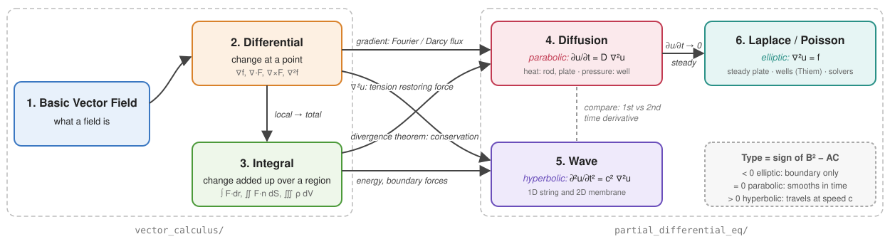

# Vector Calculus: fields, derivatives and integrals

A path through vector calculus in three notebooks: fields, derivatives and integrals. These are the tools used by the partial differential equations in [`../partial_differential_eq`](../partial_differential_eq/README.md) (diffusion, wave and Laplace/Poisson), shown as steps 4 to 6 in the diagram.

| Step | Notebook | Question it answers | Colab |
|---|---|---|---|
| 1 | [Basic_Vector_Field.ipynb](Basic_Vector_Field.ipynb) | What is a vector field, and how do we draw one? | [open](https://colab.research.google.com/github/agugun/axscnt-notebook/blob/main/vector_calculus/Basic_Vector_Field.ipynb) |
| 2 | [Vector_Calculus_Differential.ipynb](Vector_Calculus_Differential.ipynb) | How does a field change **locally**, at each point? | [open](https://colab.research.google.com/github/agugun/axscnt-notebook/blob/main/vector_calculus/Vector_Calculus_Differential.ipynb) |
| 3 | [Vector_Calculus_Integral.ipynb](Vector_Calculus_Integral.ipynb) | What is the **total** effect of a field along a curve, through a surface or inside a volume? | [open](https://colab.research.google.com/github/agugun/axscnt-notebook/blob/main/vector_calculus/Vector_Calculus_Integral.ipynb) |

## How every figure is organised

Every figure in steps 2 and 3 uses the same three-part layout, so the same reading habit works everywhere:

- **INPUT**: the field (and curve, surface or region) we start from
- **PROCESS**: the derivatives or the integrand that are calculated
- **OUTPUT**: the result and what it means

Each code cell also prints a numerical check against the exact answer, so you can see that the method works, not just that the plot looks right.

## 1. Basic Vector Field

A vector field attaches an arrow to every point in space. The notebook builds a grid with `np.meshgrid`, defines the rotating field $\mathbf F = (-y, x)$, and draws it with a quiver plot coloured by magnitude.

**Takeaway:** a field is a function you can evaluate on a grid. Everything after this is about measuring how such fields behave.

## 2. Differential vector calculus: local behaviour

Derivatives describe what a field does in a tiny neighbourhood of a point.

| Section | Operator | Turns | Measures |
|---|---|---|---|
| 1 | Gradient $\nabla f$ | scalar → vector | direction and steepness of the fastest increase |
| 2 | Directional derivative $D_{\mathbf u} f = \nabla f\cdot\mathbf u$ | scalar + direction → number | rate of change along a chosen direction |
| 3 | Divergence $\nabla\cdot\mathbf F$ | vector → scalar | sources (outflow) and sinks (inflow) |
| 6 | Identities | | $\nabla\times\nabla f = 0$, $\nabla\cdot(\nabla\times\mathbf A) = 0$, $\nabla\cdot\nabla f = \nabla^2 f$ |

Most sections share one example field, a hill and a valley, so you can follow the same landscape from its slopes (gradient) to its curvature (Laplacian).

**Takeaway:** the Laplacian is the divergence of the gradient. It is the operator that appears in the diffusion, wave and Laplace equations.

## 3. Integral vector calculus: accumulated behaviour

Integrals add up local contributions over a whole curve, surface or region.

| Section | Integral | Measures |
|---|---|---|
| 1 | Line integral $\int_C \mathbf F\cdot d\mathbf r$, circulation $\oint_C \mathbf F\cdot d\mathbf r$ | work along a path; flow around a loop |
| 2 | Surface integral $\iint_S \mathbf F\cdot\hat{\mathbf n}\,dS$ | flux: net flow through a surface |
| 3 | Volume integral $\iiint_E \rho\,dV$ | total amount (mass) and centre of mass |

Sections 2, 3 and 5 share one solid, the region under the paraboloid $z = 1 - x^2 - y^2$. The flux from section 2 and the volume integral from section 3 meet in the divergence theorem in section 5.

**Takeaway:** the divergence theorem links what crosses a boundary to what happens inside. That link is the key step in deriving the diffusion and wave equations.

## Next: partial differential equations

Steps 4 to 6 live in [`partial_differential_eq/`](../partial_differential_eq/README.md):

| Step | Notebook | Uses from here |
|---|---|---|
| 4 | [Diffusion_Equation.ipynb](../partial_differential_eq/Diffusion_Equation.ipynb) | gradient (Fourier / Darcy flux), divergence theorem (conservation), Laplacian |
| 5 | [Wave_Equation.ipynb](../partial_differential_eq/Wave_Equation.ipynb) | Laplacian (tension restoring force), integrals (energy, boundary forces) |
| 6 | [Laplace_Poisson_Equation.ipynb](../partial_differential_eq/Laplace_Poisson_Equation.ipynb) | Laplacian as neighbour average (mean-value property), divergence theorem (flux around a well) |

## Running the notebooks

Each notebook runs on its own, top to bottom, with `numpy`, `matplotlib`, `scipy` and `sympy`. Use the Colab links above, or run them locally in Jupyter or VS Code.
